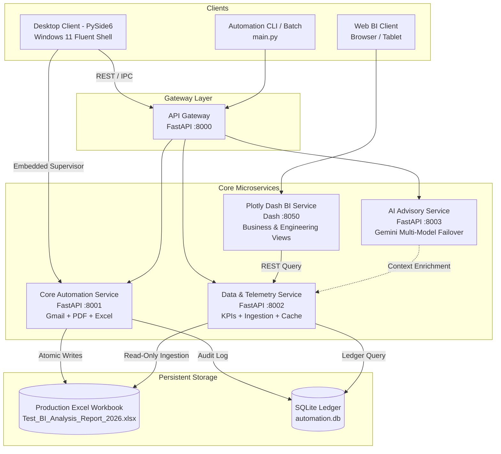

# EnergyAutomation — Architectural Blueprint & System Design

## 1. System Overview

**EnergyAutomation** is a production-grade enterprise energy intelligence and workflow automation platform developed for **Savera MS**. 

The system is structured as a decoupled, multi-tier **Microservices & Service-Oriented Architecture** inspired by the core computational engine and service models of **AutoCAD** and **MATLAB**:
1. **Core Automation Microservice (Port 8001)**: Autonomous headless ingestion engine retrieving NBSense EMS monitoring reports from Gmail, mathematical telemetry validation, atomic updates of the production Excel workbook preserving formulas, and SQLite audit logging.
2. **Data & Telemetry Microservice (Port 8002)**: Real-time telemetry ingestion, formula evaluation, data freshness monitoring, gap analysis, and KPI computation.
3. **AI Advisory Microservice (Port 8003)**: Google Gemini conversational intelligence engine featuring resilient multi-model failover (`gemini-flash-latest`, `gemini-flash-lite-latest`, `gemini-3.8-flash`) and deterministic fallback reasoning with zero fake telemetry.
4. **Interactive BI Microservice (Port 8050)**: High-performance **Plotly Dash** web application providing deep interactive analysis for business and engineering teams with Dash Bootstrap Components.
5. **Unified API Gateway (Port 8000)**: Centralized router aggregating services, health probes, and reverse proxy routing.
6. **Desktop Presentation Client (PySide6 + QFluentWidgets)**: Windows 11 Fluent Design desktop shell providing operators with operational monitoring, historical gap recovery, Gemini AI advisory, and microservice supervisor controls.

---

## 2. Microservices Architecture (AutoCAD / MATLAB Modular Pattern)



### Architectural Boundaries & Invariants

| Principle | Specification |
| :--- | :--- |
| **Sole Source of Truth** | The **Core Automation Service** is the sole authority that writes to the production Excel workbook and SQLite database. Presentation clients never write raw meter telemetry. |
| **Zero Fake Telemetry** | No synthetic, hardcoded, or random placeholder metrics. Missing or unpolled readings are strictly represented as `N/A` / `NaN` / `NO DATA AVAILABLE`. |
| **Excel Formula Safety** | Daily total formulas `=SUM(C{row}:Q{row})` and cumulative monthly row 4 formulas `=SUM(R5:R34)` are strictly preserved. Formula strings are preserved during cell persistence. |
| **Unpolled Meter Handling** | Missing meter values in reports are preserved as `NaN` / `None` / empty cells—**never coerced to `0.0`**, preventing false zero-consumption anomalies in statistical calculations. |
| **Atomic File Operations** | Excel updates are performed via temporary atomic write buffers (`temp_*.xlsx`) followed by replacement and backup creation (`data/backups/`) to prevent workbook corruption during power loss or system lock. |
| **Read-Only Analytics** | Plotly Dash BI and Gemini AI operate exclusively in read-only mode with cached queries and zero write access to production workbooks. |

---

## 3. Microservices Specification

### 3.1 Core Automation Service (Port 8001)
- **API Endpoints**:
  - `GET /health` & `GET /status`: Pipeline state, scheduler state, last run metadata.
  - `POST /run-cycle`: Triggers on-demand ingestion (Gmail -> PDF -> Validation -> Excel).
  - `POST /scheduler/start` & `POST /scheduler/stop`: Controls background cron execution.
  - `POST /recover-gaps`: Executes missing date backfilling.

### 3.2 Data & Telemetry Service (Port 8002)
- **API Endpoints**:
  - `GET /kpis`: Returns dynamic active energy, previous shift, MTD, active feeders.
  - `GET /readings`: Historical daily shift readings with date filters.
  - `GET /feeders`: Feeder catalog, zones, and consumption shares.
  - `GET /quality`: Freshness, date gaps, reconciliation metrics.

### 3.3 AI Advisory Service (Port 8003)
- **API Endpoints**:
  - `POST /ask`: Natural language Q&A with context and prompt reasoning.
  - `POST /test-connection`: Ping Gemini API with latency measurement.
  - `POST /anomaly-check`: Deterministic anomaly scan + AI interpretation.
  - `GET /status`: Model status and configuration state.

### 3.4 Plotly Dash Web BI Service (Port 8050)
- **Views**:
  - **Executive & Business Intelligence**: KPI cards, Shift-by-shift trends, Incomer vs Submeter load breakdown, Feeder Share Donut/Treemap.
  - **Engineering Analytics Grid**: Detailed feeder telemetry data table, load comparison charts, operational threshold diagnostics, outlier detection.
  - **Data Quality & Telemetry Assurance**: Ingestion freshness timeline, missing shift detection, and formula validation audits.

---

## 4. Directory Structure

```text
EnergyAutomation_new/
├── .env.example
├── .gitignore
├── LICENSE
├── README.md                      # Primary project overview & microservices guide
├── pytest.ini
├── requirements.txt               # Updated with dash, fastapi, etc.
├── run.bat                        # Primary launcher
├── run_services.bat               # Starts microservices + Dash in background
├── run_dash.bat                   # Standalone Plotly Dash launcher
│
├── config/                        # Shared system configurations
│   ├── settings.json
│   ├── meters.json
│   └── zones.json
│
├── credentials/                   # Sensitive secrets & tokens (gitignored)
│   ├── client_secret.json
│   ├── token.json
│   └── gemini/
│
├── data/                          # Shared persistent storage
│   ├── Test_BI_Analysis_Report_2026.xlsx
│   ├── automation.db
│   └── backups/
│
├── docs/                          # Professional documentation hierarchy
│   ├── admin-guide/               # Includes TROUBLESHOOTING.md & admin setup
│   ├── architecture/              # ARCHITECTURE.md (this document)
│   ├── deployment/                # DASH_DEPLOYMENT.md (migrated from Streamlit)
│   ├── developer-guide/           # API specs, AutoCAD/MATLAB modularity guide
│   ├── technical/                 # UI_UX_GUIDE.md
│   └── user-guide/                # TOUR_GUIDE.md
│
├── scripts/                       # Maintenance & administration scripts
│   └── clear_cache.py
│
├── services/                      # Decoupled Microservices Layer
│   ├── service_manager.py         # Multi-process orchestrator & supervisor
│   ├── gateway/                   # Unified API Gateway (Port 8000)
│   ├── core_automation/           # Ingestion & Validation Microservice (Port 8001)
│   ├── data_service/              # Data & Telemetry Ingestion Microservice (Port 8002)
│   ├── ai_service/                # Gemini Multi-Model Advisory Microservice (Port 8003)
│   └── dash_service/              # Plotly Dash Web BI Microservice (Port 8050)
│
├── app/                           # Core domain logic & shared contracts
├── ui/                            # Desktop PySide6 client
├── tests/                         # Pytest test suites
└── main.py                        # Central CLI & service entry point
```
